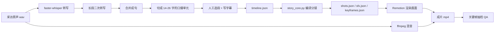

# 大学生采访 · AI 视频包装流水线

把一段「采访原声」做成 6 分钟左右的讲解型视频：

**转写 → 断句 → 选段 → 时间轴 → 分镜 → Remotion 渲染 → 混音 → 抽帧质检**

本仓库只保留**方法、脚本和示例数据**。原始素材、逐字稿、成片、受访者个人信息都没有上传，原因和检查方法见 [docs/02-隐私与版权.md](docs/02-隐私与版权.md)。

## 流水线



## 目录

| 路径 | 内容 |
|---|---|
| `pipeline/` | 转写、断句、切片、选段、时间轴脚本（纯 Python） |
| `remotion/` | Remotion 工程：分镜编译器 `story_core.py`、渲染入口、组件库 |
| `sample/` | 一套虚构的示例数据，用来跑通全流程 |
| `docs/` | 流程说明、隐私与版权清单 |

## 环境

- Windows / macOS 均可，Node ≥ 18，Python 3.10+
- `pip install faster-whisper`（转写），`ffmpeg` 在 PATH 里
- `cd remotion && npm install`（首次会下载 Remotion 的 Chrome）

## 流程

### 1. 放素材

```
work/
  source.wav          # 采访原声，16k 单声道即可
```

### 2. 转写

```bash
python pipeline/transcribe.py --audio work/source.wav --out work/raw_segments.json
python pipeline/refine_long.py --audio work/source.wav --segments work/raw_segments.json --out work/refined_segments.json
```

### 3. 断句与切片

```bash
python pipeline/make_sentences.py --in work/refined_segments.json --out work/sentences.json
python pipeline/build_units.py --in work/refined_segments.json --out work/units.json --txt work/units.txt
python pipeline/dump_segments.py --in work/refined_segments.json --out work/segments.txt
```

`units.txt` 每行是 `u001  12.30-15.80 (18) 文本`，方便通读挑选。

### 4. 选段 → 时间轴

写一个选段表（示例见 `sample/select.demo.json`）：

```json
[
  ["u001", "hook",  "字幕文字", 0, 0],
  ["u002", "who",   "字幕文字", 0.6, 0]
]
```

第 4、5 列是首尾各切掉多少秒。然后：

```bash
python pipeline/build_timeline.py --units work/units.json --select sample/select.demo.json   --out work/timeline_clips.json --edit-map work/edit_map.json

python pipeline/finalize_timeline.py --in work/timeline_clips.json --out work/timeline.json
```

`timeline.json` 就是分镜编译器的输入：每个 clip 有 `id / src / tin / tout / say / sub`。

### 5. 写分镜

`sample/scenes_demo.py` 是 6 个场景的最小示例（片名、人物卡、成本、收入、快问快答、片尾）。核心 API：

```python
sc = Scene('cost', T.t0, {'type': 'dark'})
sc.add('bignum', T.t0 + 0.02, v='200', unit='块', kicker='启动成本')
show(sc, T.t0, T.t1)
```

时间对齐用关键词：`G('S03').k('两百')` 返回这句话里「两百」被说出的绝对秒数。

### 6. 编译分镜

```bash
cd remotion
python story_core.py ../sample/timeline.demo.json ../sample/scenes_demo.py
```

输出：`src/data/shots.json`、`sfx.json`、`keyframes.json`。

### 7. 渲染

```bash
node render.mjs stills out/stills 120 360     # 抽关键帧检查
node render.mjs video out/video.mp4 0 9999 6  # 全片渲染
```

### 8. 混音与质检

- 人声：`ffmpeg -i source.wav -af loudnorm=I=-19.5:TP=-1.5:LRA=11 voice.wav`
- 音乐垫底约 -33 LUFS，转折处用 `sfx.json` 里的时间点贴音效
- 抽 10-20 帧看字幕压边、数字遮挡、人脸位置，再整体回放一遍

## 示例数据能跑到哪一步

`sample/` 里的数据是**虚构的**，可以直接跑 `story_core.py` 验证分镜编译；渲染需要自备 `public/clips/*.mp4`、字体和音乐。

## 常见坑

- whisper 长段会丢句：超过 12 秒的段切出来二次转写，再合并。
- 中文 JSON 在 Windows 下容易按 GBK 打开：所有脚本显式 `encoding='utf-8'`，运行时设 `PYTHONUTF8=1`。
- Remotion 首次渲染要联网下载 Chrome；离线机器先跑一次 `npx remotion browser ensure`。
- 素材帧率要和合成帧率对齐（本项目 24fps），否则会出现重复帧、观感发顿。
